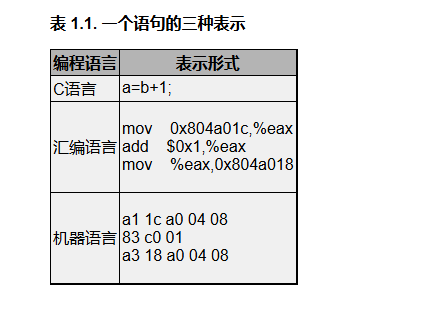
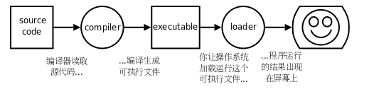

# 程序的基本概念
## 1.程序和编程语言
### 指令（Instruction）
指令是指示计算机做某种运算的命令，包括：  
- **输入（Input）**：从键盘、文件或者其它设备获取数据。  
- **输出（Output）**：把数据显示到屏幕，或者存入一个文件，或者发送到其它设备。  
- **基本运算**：执行最基本的数学运算（加减乘除）和数据存取。
**测试和分支**：测试某个条件，然后根据不同的测试结果执行不同的后续指令。  
- **循环**：重复执行一系列操作。
### 程序（Program）
由一系列 **指令**（Instruction）组成，目的是告诉计算机应如何完成一个计算任务。计算机是由数字电路组成的运算机器，只能对数字做运算，程序之所以能做符号运算，是因为符号在计算机内部也是用数字表示的。  
**编写程序可以说就是这样一个过程：把复杂的任务分解成子任务，把子任务再分解成更简单的任务，层层分解，直到最后简单得可以用以上指令来完成。**
### 编程语言（Programming Language）
编程语言分为低级语言（Low-level Language）和高级语言（High-level Language）  
1. 低级语言：直接用计算机指令编写程序
- 机器语言（Machine Language）  
符号、声音、图像在计算机内部都要用数字表示，指令也不例外，机器语言完全由十六进制数字组成。直接用机器语言编程需要查大量的表格来确定每个数字表示什么意思。
- 汇编语言（Assembly Language）  
汇编语言把机器语言中一组一组的数字用**助记符**（Mnemonic）表示，直接用这些助记符写出汇编程序，然后让**汇编器**（Assembler）去查表把助记符替换成数字，也就把汇编语言翻译成了机器语言
2. 高级语言
C、C++、Java、Python等属于高级语言，用**语句**（Statement）编写程序，语句是计算机指令的抽象表示。

一条a=b+1;语句要翻译成三条汇编或机器指令，这个过程称为**编译**（Compile），由**编译器**（Compiler）来完成。用C语言编写的程序必须经过编译转成机器指令才能被计算机执行，编译需要花一些时间，这是用高级语言编程的一个缺点，然而更多的是优点。首先，用C语言编程更容易，写出来的代码更紧凑，可读性更强，出了错也更容易改正。其次，C语言是可移植的（Portable）或者称为平台无关的（Platform Independent）。
**总结:c语言通过编译翻译成机器指令**
### 编译执行过程
1. 文本编辑器写一个C程序，然后保存成一个文件，例如program.c（通常C程序的文件名后缀是.c），这称为源代码（Source Code）或源文件。
2. 运行编译器编译.c文件，编译过程不执行程序，而是把源代码全部翻译成机器指令，再加上一些描述信息，生成一个新的文件，例如a.out，这称为可执行文件，可执行文件可以被操作系统加载运行。
3. 计算机执行.out文件中由编译器生成的指令

> **解释执行相比编译执行，其优缺点主要体现在平台无关性和执行效率的权衡上：**
> 
> **优点在于平台无关性和开发灵活性。** 因为高级语言和机器语言不是一一对应的，解释执行不需要提前生成针对特定硬件的机器码（二进制可执行文件），只要有对应的解释器，源码即可跨平台运行，实现了“平台无关”。同时，它省去了编译链接环节，修改后立刻执行，非常适合快速开发和自动化脚本。
> 
> **缺点在于执行效率低和依赖解释器。** 编译执行是在运行前一次性翻译成机器码，而解释执行是在运行过程中“边翻译边执行”，多了翻译的时间开销，运行效率相对较低。此外，解释执行的程序无法脱离解释器独立运行，且源码是以文本形式暴露的，保密性较差。
> 
> **总结**：编写操作系统或对性能要求极高的核心程序多用编译型语言（如C）；而编写运维脚本、数据处理或对跨平台要求高的应用，多用解释型语言（如Shell、Python）。两者是不同场景下的权衡。
## 2.自然语言与形式语言总结
### 核心定义
*   **自然语言 (Natural Language)**：人类进化的语言（如汉语、英语）。充满歧义，依赖上下文和常识。
*   **形式语言 (Formal Language)**：为特定应用人为设计的语言（如数学符号、化学式、**编程语言**）。设计目标是**清晰、无歧义**。
### 形式语言的语法体系
*   **Token（符号）**：相当于自然语言中的单词，由**词法 (Lexical)** 规则约束。
*   **Structure（结构）**：Token的排列方式，由**语法 (Grammar)** 规则约束。
*   *示例*：`3+3=6` 合法；`3+=+6$` 存在词法错误（`+=`不是运算符）和结构错误（`$`位置错误）。
*   **解析 (Parse)**：分析句子结构的过程（如提取主谓宾）。
*   **语义 (Semantic)**：理解句子的实际含义和上下文。
### 自然语言 vs 形式语言的核心差异
| 特性 | 自然语言 | 形式语言 |
| :--- | :--- | :--- |
| **歧义性 (Ambiguity)** | 充满歧义，依赖上下文消除 | 必须绝对无歧义，与上下文无关 |
| **冗余性 (Redundancy)** | 冗余多（为消除歧义而��嗦） | 极其紧凑，极少冗余 |
| **字面一致性 (Literalness)** | 充满成语、隐喻、反讽 | 字面意思即真实意思（特例如C语言转义字符除外） |
### 类比理解（诗歌 vs 说明文 vs 程序）
*   **诗歌**：发音与意义并重，刻意使用歧义和隐喻，强调整体情感。
*   **说明文**：字面意思重要，结构传递信息，但仍有一定歧义。
*   **程序**：**完全无歧义**，字面与真实意思一致，可通过 Token 和结构完全解析。
### 阅读程序代码的建议
*   形式语言更紧凑，需花更多时间阅读。
*   **重结构**：不要纯粹从左到右死读，要在脑中**解析结构、识别Token**。
*   **抠细节**：自然语言中可忽略的拼写和标点错误，在形式语言中往往是致命的。
*   **应对困难**：人类适应形式语言需要一个过程（类似于读说明文）。
### 补充说明（术语避坑）
*   `Syntax` 和 `Grammar` 中文常都译为“语法”，极易混淆。
*   `Syntax` 实际包含 Lexical（词法）和 Grammar（语法）规则，甚至包含部分语义规则（如C语言变量先声明后使用）。
*   英文文献中也常混用，建议阅读时结合上下文，或**直接使用英文原词（如 Token）**以避免歧义。
# 程序的基本概念

## 3. 程序的调试

### 调试的背景
* **Bug 的起源**：早期计算机故障是因为飞虫（Bug）钻进机器，此后程序错误被称为 Bug。
* **调试（Debug）**：找到 Bug 并加以纠正的过程。需要概念明确、逻辑清晰、性格沉稳和一点运气。
* **首要任务**：区分程序中的 Bug 属于哪一类。

### 错误的分类
#### 编译时错误 (Compile-time errors)
* **原因**：编译器只能翻译语法正确的程序，任何微小的语法错误都会导致编译失败，无法生成可执行文件。
* **特点**：编译器非常严格（不像自然语言容忍小错）。错误提示有时会有帮助，有时会误导。
* **难度**：**最简单、最容易解决**。初学者可能花费大量时间，但经验丰富后容易发现。

#### 运行时错误 (Run-time errors)
* **原因**：编译器检查不出，能生成可执行文件，但在运行时出错导致程序崩溃。
* **特点**：简单程序中很少，但在后续复杂程序中会越来越多。
* **关键要求**：必须严格区分**编译时（Compile-time）**和**运行时（Run-time）**这两个概念（不仅是调试，学习C语言也需要区分）。

#### 逻辑错误和语义错误 (Logic/Semantic errors)
* **原因**：编译和运行顺利，无报错信息。但程序没有干该干的事，而是干了别的事。
* **本质**：计算机只会执行写的代码，但代码不是真正想要的（程序语义错误）。
* **难度**：**最难解决**。需要清醒的头脑，通过观察程序的输出，回头判断它到底在做什么。

### 调试的方法与本质
* **侦探工作**：调试是最需要动脑、最有挑战和乐趣的部分。根据线索推断原因和过程。
* **实验科学**：假设 -> 修改程序 -> 运行 -> 验证。若假设正确，继续下一个 Bug；若错误，重新假设。
* **福尔摩斯名言**：“当你把不可能的全都删除，剩下的――即使看起来再怎么可能――就一定是事实。”

### 编程与调试的实践建议
* **编程即调试**：编程的过程就是逐步调试直到获得期望结果的过程。
* **小步快跑**：总是从一个能正确运行的小规模程序开始，每做一步小的改动就立刻进行调试。
* **Linus 案例**：Linux 系统包含成千上万行代码，一开始仅仅是 Linus Torvalds 用来琢磨 Intel 80386 芯片而写的一个交替打印 AAAA 和 BBBB 的小程序。这种逐步迭代的思想最终演变成了 Linux。

> **总结**：调试是编程中最困难的部分，但也是最能体现解决问题能力的部分。保持耐心，逐步缩小范围，是从新手走向高手的必经之路。