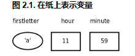
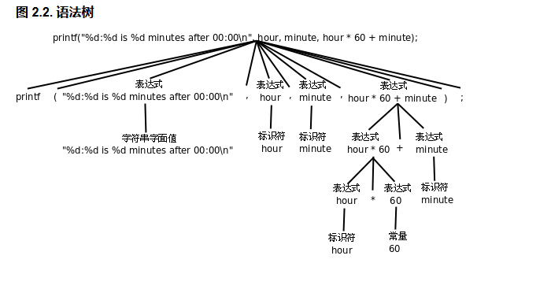

# 1. 继续Hello World

## 注释（Comment）
*   **跨行与拼接**：注释可以跨行，也可以穿插在程序之中。示例2.1展示了多行注释和行内注释的组合使用。
*   **注释不能嵌套**：`/* text1 /* text2 */ text3 */` 是错误的。编译器将 `/*` 到第一个 `*/` 之间的内容视为注释，后面的 `text3 */` 会因无法解析而报错。
*   **行注释**：`//` 表示从这里到行末的字符均属于注释，不能跨行。该语法从 C++ 借鉴，在 C99 中被标准化。
*   **格式**：多行注释中间每行开头的 `*` 没有特殊含义，只是代码风格约定，为了看起来整齐。

## C语言标准
*   **发展历史**：Old Style C -> C89 (ANSI/ISO) -> C99。
*   **C89**：1989年提出，是最广泛支持的版本。经典教材 K&R 即基于此版本，当前绝大多数编译器完全支持。
*   **C99**：1999年推出，加入许多新特性，但至今未被广泛支持，连 gcc 也没有完全实现。
*   **本书约定**：以 C89 为准，少用 C99 新特性。C标准旨在精确、无歧义，而非为了教学，因此不易看懂。

## 字符串字面量与转义序列（Escape Sequence）
*   **字符串字面量**：被双引号（Double Quote）引起的一串字符（如 `"Hello, world.\n"`）。双引号是界定符，不打印。
*   **转义序列**：C语言规定 `\n` 不代表字面的反斜杠和n，而是表示**换行符（Line Feed）**。因此打印结果中没有 `\n` 这两个字符，而是执行了换行操作。
*   **C标准规定的转义字符表（表2.1）**：
    *   `\'` 单引号
    *   `\"` 双引号
    *   `\?` 问号
    *   `\\` 反斜线
    *   `\a` 响铃
    *   `\b` 退格
    *   `\f` 分页
    *   `\n` 换行
    *   `\r` 回车
    *   `\t` 水平制表符
    *   `\v` 垂直制表符

### 转义序列的作用与历史背景
1.  **表示特殊字符**：例如 `\n` 转成换行。
2.  **转义普通字符**：在字符常量中，要表示单引号和问号可以直接使用，但表示 `'` 和 `"` 必须用转义，因为它们分别是界定符。
3.  **控制字符的作用**：
    *   `\a` 在终端响铃。
    *   `\r` 是回车（Carriage Return），`\n` 是换行（Line Feed）。这源于老式打字机的两个动作。Windows 文本文件用 `\r\n` 做分隔符，而 Linux/Unix 文本文件只用 `\n`。
    *   `\t` 在终端下表示制表符。

## 空白字符与代码风格
*   **字符串中的空格**：字符串字面量中的空格也算一个字符，会出现在输出结果中（如 `"Goodbye, "` 末尾的空格）。
*   **代码中的空白（空格、Tab、换行）**：
    *   程序中到处多一个少一个空白字符，**不会对编译结果产生任何影响**，也不会影响程序的运行结果。
    *   甚至可以把整个程序写成一行：`#include <stdio.h> int main(void){printf("Hello, world.\n");return 0;}`。但 `#include` 必须独占一行。
    *   但 `int` 和 `main` 之间至少要有空格分隔。
*   **代码风格与可读性**：
    *   虽然编译器不关心格式，但写成一行严重影响**可读性**。
    *   如果报错提示第2行有错，很难判断是哪条语句出错。
    *   好的代码风格要求：**缩进整齐、每个语句一行、适当留空行**。
# 2.常量

## 字符常量
- **界定符**：用单引号 `'` 括起来（如 `'}'`）。只能包含一个字符，不能像双引号那样包含一串字符。
- **转义序列**：字符常量也可以是一个转义序列（如 `'\n'`），虽然单引号内有两个字符，但实际上只代表一个字符。
- **特殊字符规则**：
  - 在字符常量中表示双引号 `"` 和问号 `?`，既可以使用转义序列，也可以直接使用字符本身。
  - 但表示单引号 `'` 则必须使用转义序列（`'\''`）。

## 数据类型（Type）
- 计算机中整数和小数的内部表示方式不同，在 C 语言中是两种不同的类型（Type），如 `34` 是整数，`3.14` 是浮点数。

## 格式化字符串与转换说明
- **格式化字符串（Format String）**：`printf` 的第一个字符串参数（如 `"character: %c\n..."`）。
- **转换说明（Conversion Specification）**：格式化字符串中 `%` 后加上字母（如 `%c`、`%d`、`%f`），分别表示字符型、整型和浮点型的转换说明。
- **占位符（Placeholder）**：转换说明只在格式化字符串中占个位置，不出现在最终的打印结果中。
- **输出结果**（格式与直接打印字符串不同）：
## 编译时与运行时的处理
- **编译时处理**：源文件中的字符串字面值 `"character: %c\n..."`。其中的 `\n` 被替换为一个换行符，`%c` 不变，编译后保存在可执行文件中。
- **运行时处理**：运行时字符串被传给 `printf`，`printf` 再把其中的 `%c`、`%d`、`%f` 解析成转换说明并进行输出。

## 易混淆点
- **严格区分类型**：注意区分 `"5"`（字符串字面值，双引号界定）、`'5'`（字符常量，单引号界定）、`5`（整数常量，无界定符）。

## 习题解答

### 习题1：总结前面介绍的转义序列的规律，想想在 `printf` 的格式化字符串中怎么表示一个 `%` 字符？写个小程序试验一下。

#### 1. 转义序列的规律
- **统一前缀**：转义序列均以反斜杠 `\` 开头。
- **作用**：
- 将普通字符转为特殊含义（如 `\n` 表示换行，`\t` 表示制表符）。
- 将特殊字符转为普通字面值（如 `\"` 表示双引号，`\\` 表示反斜杠本身）。
- **字符常量 vs 字符串字量**：在字符常量中，`"` 和 `?` 可以使用转义或直接书写，但 `'` 必须转义；在字符串字量中，`"` 必须转义。

#### 2. 如何表示 `%` 字符？
在 `printf` 的格式化字符串中，`%` 是转换说明的引导符。要输出一个普通的 `%` 字符，需要使用 `%%` 进行转义。编译器遇到 `%%` 时，会在最终输出中打印一个 `%`。

#### 3. 试验小程序
```c
#include <stdio.h>

int main(void)
{
    printf("The percentage sign is: %%\n");
    printf("Discount: 50%% off!\n");
    return 0;
}
```
#### 预期输出结果：
> The percentage sign is: %  
> Discount: 50% off!

# 3. 变量

## 变量的基本概念
- **定义**：变量（Variable）是编程语言最重要的概念之一，是计算机存储中一块**命名的空间**。
- **作用**：可以在里面存储一个值（Value），且存储的值可以**随时改变**（如先存字符 `a`，下次存字符 `b`）。
- **类型与空间**：常量有不同的类型，因此变量也有不同的类型。变量的类型决定了它所占的存储空间的大小。
- **示例**：
> char fred;  
> int bob;  
> float jimmy;  
> double tom;
## 声明和定义（高亮框重点）
- **声明（Declaration）**：C语言中的声明有变量声明、函数声明和类型声明三种。
- **定义（Definition）**：如果一个变量或函数的声明要求编译器为它分配存储空间，那么也可以称为定义，因此**定义是声明的一种**。
- **本阶段约定**：接下来几章的示例代码中变量声明都要分配存储空间，因此都是定义。等学到“定义和声明”一节，会看到函数声明和类型声明也是区分开的（分配存储空间的叫定义，不分配存储空间的叫类型声明）。
- **位置与结尾**：声明和语句类似，也是以分号结尾。但**语句只能出现在 `{}` 中，而声明既可以出现在 `{}` 中也可以出现在所有 `{}` 之外**。

## 浮点型与变量声明建议
- **浮点型分类**：
- `float`：单精度浮点型。
- `double`：双精度浮点型。
- `long double`：精度更高的浮点型。
- （区别和转换规则将在第15章“数据类型详细”介绍）。
- **常量与转换说明**：上一节介绍的常量 `3.14` 应该看作 `double` 类型的常量，`printf` 的 `%f` 也应该看作 `double` 型的转换说明。
- **命名规范**：给变量起名不能太随意（如 `fred`、`bob` 不好，看不出用途）。推荐如下命名：
>char firstletter;  
>char lastletter;  
>int hour, minute;
- `firstletter`、`lastletter` 取值范围应是 `'a'~'z'` 或 `'A'~'Z'`。
- `hour` 取值范围是 `0~23`，`minute` 取值范围是 `0~59`。
- **声明技巧**：相同类型的变量（如 `hour` 和 `minute`）可以一起声明。

## 标识符与关键字
### 标识符（Identifier）
- **命名规则**：C语言规定必须以字母或下划线（Underscore）开头，后面可以跟若干个字母、数字、下划线，**不能有其它字符**。
- **合法示例**：`abc`、`_abc`、`_123`。
- **不合法示例**：`3abc`、`a#t`。
- **适用对象**：不仅适用于变量名，也适用于所有可以由程序员起名的语法元素（如函数名、宏定义、结构体成员等）。在C语言中这些统称为标识符。

### 关键字（Keyword）
- **定义**：在C语言中有特殊意义，不允许用作标识符的单词称为关键字（Keyword）或保留字（Reserved Word）。
- **常见类型**：`char`、`int`、`float`、`double` 等虽然符合标识符规则，但不能用作标识符。
- **编辑器提示**：通常用于编程的文本编辑器都会高亮显示这些关键字，只要小心一点通常不会误用。
- **C99规定的关键字列表**：  
>auto break case char const continue default do double else enum extern float for goto if inline int long register restrict return short signed sizeof static struct switch typedef union unsigned void volatile while _Bool _Complex _Imaginary

### 下划线开头的标识符
- **避免使用**：一般应避免使用以下划线开头的标识符。
- **原因**：虽然只要不和C语言关键字冲突都是合法的，但往往被编译器用作一些功能扩展，C标准库也定义了很多以下划线开头的标识符，容易造成**命名冲突**（除非对编译器和C标准库特别清楚）。

## 学习建议
- 理解一个概念不是把定义背下来就行了，一定要理解它的外延和内涵。
- 要知道：什么情况属于这个概念，什么情况不属于这个概念，什么情况虽然属于这个概念但一般推荐的做法（Best Practice）是要尽量避免这种情况。这才算是真正理解了。
# 4. 赋值

## 赋值语句与基本规则
- **定义**：定义变量后，要把值存到它们所表示的存储空间里，用**赋值（Assignment）**语句实现。
- **示例代码**：
```c
char firstletter;
int hour, minute;
firstletter = 'a'; /* give firstletter the value 'a' */
hour = 11; /* assign the value 11 to hour */
minute = 59; /* set minute to 59 */
```
- **核心规则**：
- **先声明后使用**：编译器必须先看到变量声明，才知道变量名和存储空间大小。
- **`=` 是赋值号，不是数学等号**：`i = i + 1` 在 C 语言中合法（取出 `i` 的值加 1 后再存回去），而在数学中不成立。
- **总结**：定义一个变量就是分配一块存储空间并给它命名；给一个变量赋值，就是把一个值保存到这块存储空间中。

## 初始化（Initialization）
- **定义**：变量的定义和赋值也可以一步完成，这称为变量的初始化。
- **示例**：
```c
char firstletter = 'a';
int hour = 11, minute = 59;
```
- **Initializer**：等号右边的值叫做 Initializer（如 `'a'`、`11` 和 `59`）。
- **特性**：初始化是一种特殊的声明，而不是一种赋值语句。目前看来先定义再赋值和定义时初始化效果一样，很多语法规则也适用于两者，但以后会学到它们之间的不同（需注意总结异同之处）。

## 内存示意图与类型限制（图2.1）

- **图示**：在纸上画一个框表示变量的存储空间，框外标变量名，框里记上它的值（如 `firstletter` 框内写 `'a'`，`hour` 框内写 `11`，`minute` 框内写 `59`）。
- **类型匹配**：用不同形状的框表示不同类型的变量。所赋的值必须符合它的类型。
- **类型不匹配错误示例（语义错误）**：
```c
int hour, minute;
hour = "Hello."; /* WRONG ! */
hour = "59"; /* WRONG ! */
```
- 注意：`hour = "59";` 把 `"59"` 赋给 `minute` 看起来像对的，但是类型不对，字符串不能赋给整型变量。

## 读取变量值与存储空间
- **读取值**：既然可以给变量赋值，就应该可以把值取出来用，现在我们取出这些变量的值用 `printf` 打印：
```c
printf("Current time is %d:%d", hour, minute);
```
- **使用区别**：变量名用在等号左边表示赋值，用在 `printf` 中表示把它存储空间中的值取出来替换在那里。
- **存储大小**：不同类型的变量所占的存储空间大小是不同的，数据表示方式也不同。变量的最小存储单位是字节（Byte）。C语言中 `char` 型变量占一个字节，其它类型的变量占多少字节在不同平台上有不同的规定（将在第15章“数据类型详细”详述）。

# 5. 表达式

## 表达式与运算符
- **表达式（Expression）**：常量和变量参与加减乘除运算，如 `hour * 60 + minute`。运算符（Operator）有 `+ - * /`，参与运算的常量和变量称为操作数（Operand）。
- **优先级（Precedence）**：`*` 和 `/` 是同一优先级，`+` 和 `-` 是同一优先级，前者的优先级高于后者。同一优先级的运算从左到右计算。括号 `()` 可以改变默认优先级（如 `(3+4)*5`）。
- **表达式语句**：在任意表达式后面加个分号 `;` 就构成表达式语句（如 `hour * 60 + minute;`，但这句没有保存结果，无实际作用）。

## 赋值运算符与结合性
- **赋值运算符 `=`**：也是一种运算符，优先级比 `+` 和 `-` 都低。赋值语句就是一种表达式语句。
```c
int total_minute;
total_minute = hour * 60 + minute;
```
- **表达式的属性**：任何表达式都有**值（Value）**和**类型（Type）**两个基本属性。上面表达式的类型是 `int`（由操作数类型决定），其值等于等号左边被赋予的值（也即 `hour * 60 + minute` 的值）。
- **结合性（Associativity）**：
- `+ - * /` 是左结合的（从左到右计算）。
- `=` 是右结合的（从右到左计算）。例如 `total = total_minute = hour * 60 + minute;`，先算右边，再依次赋给左边。

## 语法规则（简化版）与语法树
- **语法规则**：
>表达式 → 标识符  
表达式 → 常量  
表达式 → 字符串字面值  
表达式 → (表达式)  
表达式 → 表达式 + 表达式  
表达式 → 表达式 - 表达式  
表达式 → 表达式 * 表达式  
表达式 → 表达式 / 表达式  
表达式 → 表达式 = 表达式  
语句 → 表达式;  
语句 → printf(表达式, 表达式, 表达式, ...);  
变量声明 → 类型 标识符 = Initializer, 标识符 = Initializer, ...;  
- **语法树（图2.2）**：编译器根据语法规则把语句解析成语法树，然后再生成指令。树的末端是 Token，每一步展开用一条语法规则。

- **组合（Composition）**：可以根据语法规则任意组合出复杂的程序（例如在一条语句中完成计算、赋值和打印）。但表达式不宜过度组合，否则会给阅读和调试带来困难。

## 左值（Lvalue）与右值（Rvalue）
- **左值（Lvalue）**：等号左边的表达式要求表示一个存储位置，可以放在等号左边的表达式称为左值。
- **右值（Rvalue）**：只能表示值的表达式称为右值（只能放在等号右边）。
- `minute + 1 = hour;` 是错误的，因为 `minute + 1` 是右值，不能表示存储位置。
- `a = b = c` 是合法的（`b = c` 的结果作为左值赋给 `a`），但 `(a = b) = c` 是不合法的，因为 `a = b` 的结果是右值，不能作为左值。

## 整数除法与类型转换
- **整数除法（截断）**：两个 `int` 型操作数相除的表达式仍为 `int` 型，只能保存计算结果的整数部分，即使小数部分是 0.98 也要舍去（如 `59 / 60` 结果为 `0`）。
- **取整规则**：
- 向下取整称为 Floor，用数学符号 `|_|` 表示。
- 向上取整称为 Ceiling，用数学符号 `|-|` 表示。
- C 语言中整数除法的规则既不是 Floor 也不是 Ceiling，而是**向零截断（Truncate toward Zero）**。即正数时相当于 Floor，负数时相当于 Ceiling。
- **浮点数除法与类型转换**：
- 表达式 `minute / 60.0` 中，`60.0` 是 `double` 型，C 语言规定了一套隐式类型转换规则。编译器自动把左边的 `minute` 转成 `double` 型来计算，整个表达式的值也是 `double` 型。
- 在格式化字符串中应使用 `%f` 转换说明与之对应。
- C 语言允许隐式类型转换是为了书写简便，但规则不易掌握，本书前几章会尽量避免类型转换。

---

## ? 习题解答

**习题1：假设变量 `x` 和 `n` 是两个正整数，我们知道 `x/n` 这个表达式的结果要取 Floor。如果希望结果取 Ceiling 应该怎么写表达式呢？例如 x 是 17，n 是 4，则结果是 5；x 是 16，n 是 4，则结果是 4。**

### 解答：
**表达式：`(x + n - 1) / n`**

### 原理解析与验证：
因为 `x`、`n` 均为正整数，且 C 语言整数除法是向零截断（正数时等同于 Floor）。

1. **当 `x` 能被 `n` 整除时（如 `x=16, n=4`）**：
 `(16 + 4 - 1) / 4 = 19 / 4 = 4`（整数除法截断小数部分，结果为 4）。符合题目预期。
2. **当 `x` 不能被 `n` 整除时（如 `x=17, n=4`）**：
 `(17 + 4 - 1) / 4 = 20 / 4 = 5`。符合题目预期。

**数学推导逻辑**：
`Ceiling(x / n)` 等价于 `Floor((x + n - 1) / n)`。给被除数加上 `n - 1`（即除数减一），这样只要余数不为 0，加上 `n - 1` 后必然能多凑出一个 `n`，从而实现向上取整；如果余数为 0，加上 `n - 1` 后仍然不够一个 `n`，向下取整后结果不变。

**验证代码：**
```c
# include <stdio.h>
int main(void)
{
int x = 17, n = 4;
printf("Ceiling of %d/%d is: %d\n", x, n, (x + n - 1) / n); // 输出 5

x = 16;
printf("Ceiling of %d/%d is: %d\n", x, n, (x + n - 1) / n); // 输出 4

return 0;
}
```

# 6. 字符类型与字符编码

## 字符参与整数运算
* **示例**：`printf("%c\n", 'a'+1);`，执行结果是 `b`。
* **原理**：字符常量或字符型变量也可以当作整数参与运算。

## 字符编码与ASCII码
* **字符编码（Character Encoding）**：符号在计算机内部也用数字表示，每个字符对应一个整数。
* **ASCII码**：目前最常用的编码（American Standard Code for Information Interchange，美国信息交换标准码）。
* **ASCII码表特征**：
  * 取值范围：`0~127`。
  * 表中每一栏最后一列是字符，前三列是用十进制（Dec）、十六进制（Hx）和八进制（Oct）表示的字符编码。
  * 很多字符是不可见字符（Non-printable Character）或空白字符（Whitespace），如 CR (Carriage Return)、LF (NL, line feed, newline)、DEL 等，不能用字符本身填在表中，而用名字描述。

## 字符的本质与整数类型
* **运算过程**：`'a'` 在 ASCII 码中是 97，`'b'` 是 98。计算 `'a'+1` 时，将 `'a'` 当作整数 97，加 1 得到 98，然后 `printf` 把 98 这个整数值当作 ASCII 码来解释，打印出相应的字符 `b`。
* **整数类型（Integer Type）**：`char` 型本质上就是整数，只不过取值范围比 `int` 型小。所以 `char` 型和 `int` 型统称为整数类型或整型。

## ASCII码的连续性规律
* **连续范围**：`'a'~'z'`、`'A'~'Z'`、`'0'~'9'` 的 ASCII 码是连续的。
* **等式示例**：`'a'+25` 和 `'z'` 的值相等；`'0'+9` 和 `'9'` 的值也相等。
* **注意区分**：`'0'~'9'` 的 ASCII 码是十六进制的 `30~39`，和整数值 `0~9` 是不相等的（例如字符 `'0'` 的 ASCII 码是 48，不是 0）。

## 字符的转义序列表示
* **表示方法**：字符也可以用 ASCII 码转义序列表示。这种转义序列由加上 1~3 个八进制数字组成，或者由 `\x` 或大写 `\X` 加上 1~2 个十六进制数字组成。可以用在字符常量或字符串字面值中。
* **常见示例**：
  * `'\0'` 表示 NUL 字符（Null Character）。
  * `'\11'` 或 `'\x9'` 表示 Tab 字符。
  * `'\11'` 或 `'\x9'` 表示由 Tab 字符组成的字符串。
* **易错点**：注意 `'0'` 的 ASCII 码是 48，而 `'\0'` 的 ASCII 码是 0，两者是不同的。

---
**? 脚注补充**
* **空白字符**：在不同的上下文中有不同的含义，在 C 语言中空白字符定义为空格、水平 Tab、垂直 Tab、换行和分页符。本书在使用“空白字符”这个词时会明确说明在当前上下文中空白字符指的是哪些字符。